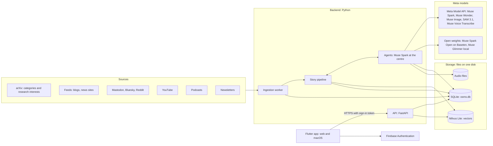
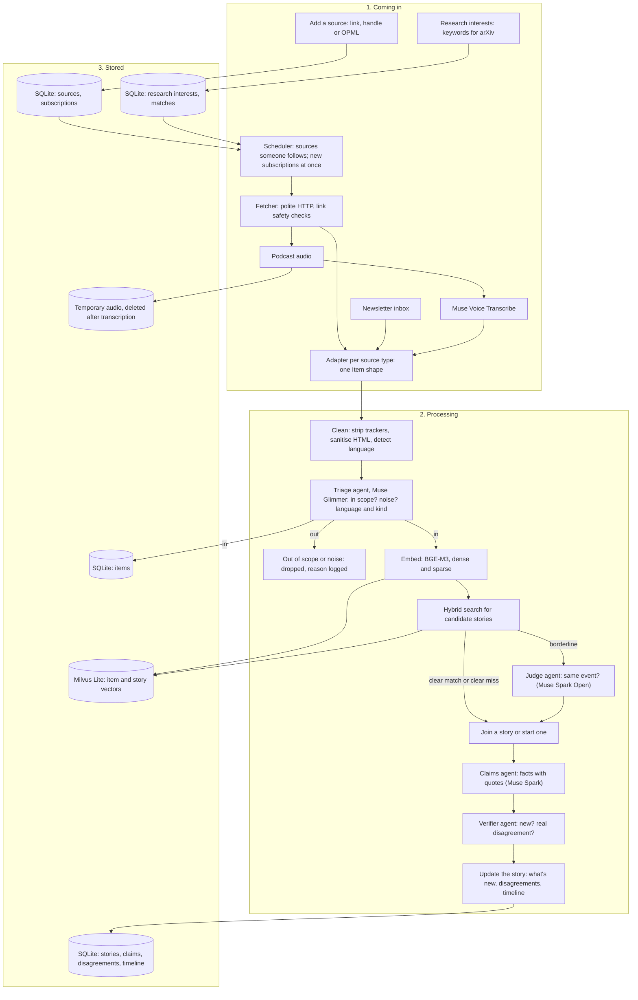
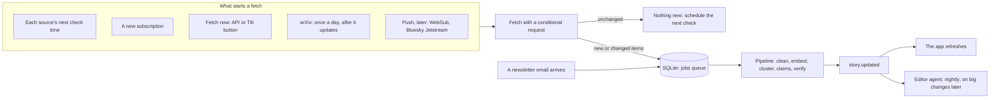
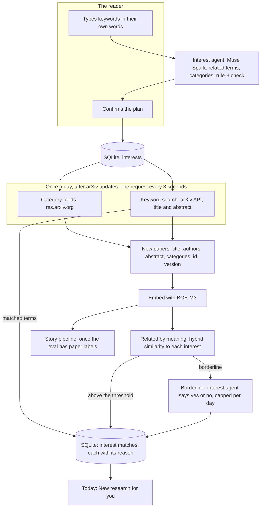
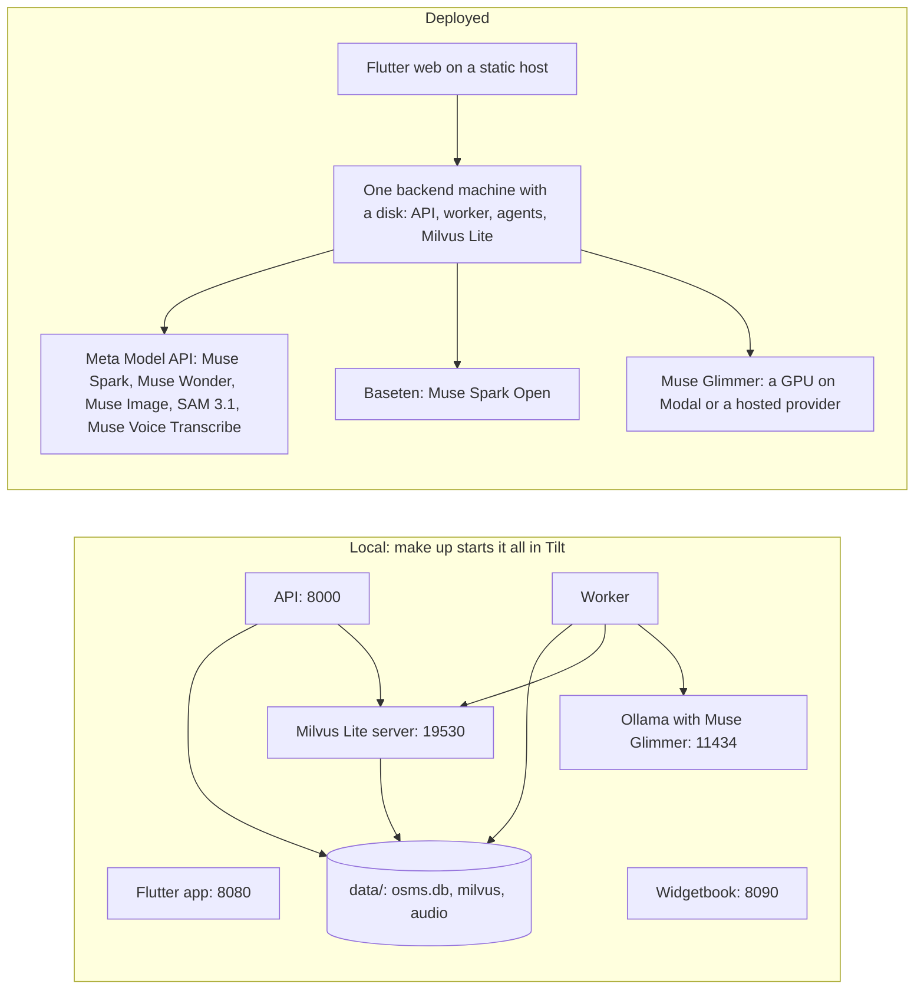

# Architecture

How OSMS turns many sources into one story, where the data lives, which agents make the
judgement calls, and which Meta model does what.

## At a glance



Plain code does the heavy, predictable work: fetching, parsing, embedding, vector search.
Meta models make the judgement calls: is this item in scope, is this the same event, what
are the facts, is this new, is this a real disagreement, what matters today and how to
say it. A different model checks everything generated before a reader sees it.

## How data comes in, is processed and stored



### 1. Coming in

- **Sources** are added from one box: a link (feed autodiscovery), a handle
  (`@user@instance`, `r/name`, a YouTube channel, ...) or an OPML file. Sources are shared:
  a feed two readers follow is fetched once.
- **arXiv** is a main source, read two ways: category feeds, and searches built from each
  reader's research keywords. See *arXiv: from keywords to papers* below.
- **The scheduler** checks every source at least one reader follows, each on its own
  schedule, and fetches a new subscription straight away (see *Staying up to date*).
- **The fetcher** uses conditional requests, per-host rate limits and backs off on
  `429`. It only follows public http(s) links, re-checked after every redirect.
- **One adapter per source type** turns feeds, papers, posts, videos, episodes and
  newsletters into the same `Item`: source, kind, title, text, link, time, language, media
  links. A paper also carries its authors, categories, arXiv id and version.
- **Podcasts** are the only media we download, and only to transcribe them with Muse Voice
  Transcribe, biased towards the source's and story's names; the audio is deleted
  afterwards. Images and videos stay where they are, and no model sees them.

### Staying up to date

Sources are checked on a schedule, and sources that can push trigger a fetch the moment
they publish. Either way, every new or changed item starts the pipeline at once.



- **Each source gets its own check interval:** about half its usual gap between items,
  between 5 minutes and 6 hours. It also follows the feed's own hints (`<ttl>`,
  `Cache-Control`, `Retry-After`).
- **Conditional requests** make a check almost free when nothing changed: no parsing, no
  model calls.
- **Push** (later, once the backend is public): WebSub for feeds with a hub, YouTube
  included; Bluesky Jetstream for posts; newsletters already arrive by email. A slow
  safety-net check stays on, because pushes can be missed.
- **arXiv** updates once a day (midnight US Eastern, around 06:00 Danish time), so its
  category feeds and interest searches run once, just after.
- **The jobs queue** lives in SQLite, so a restart loses nothing and failures retry.
- **The agents don't search the web.** What they know is what the sources delivered, and
  every fact carries its date.

### arXiv: from keywords to papers

A reader types their area of interest in their own words, and OSMS pulls every new paper
that mentions it or is related to it by meaning.



- **The plan comes first.** The interest agent suggests related terms ("RAG" for
  "retrieval-augmented generation"), likely categories, and flags keywords outside rule 3,
  which are never searched. The reader sees the plan in plain words and confirms it.
- **Keyword matches** come from one arXiv API query per interest: quoted phrases in title
  and abstract, joined with `OR`, narrowed to the reader's categories. Identical queries
  from different readers run once; matches are stored per reader.
- **Related by meaning** catches papers that use none of the keywords: every new paper in
  the followed categories is embedded with BGE-M3 and compared with each interest. The
  author sets the threshold with the eval; only borderline papers reach the agent.
- **A new interest starts full:** it is backfilled with the last 30 days.
- **Every match says why:** the terms it matched, or "related to your interests".
- **arXiv's terms:** one request every three seconds and one connection for all of OSMS;
  metadata (CC0) is stored, PDFs never are: cards link to the abstract page and the PDF on
  arXiv. Claims come from the title and abstract only.
- **Interests are personal:** stored per reader, never shared or logged; arXiv sees the
  search text, never who asked.

### 2. Processing

- **Clean:** strip tracking pixels and unsubscribe links, sanitise HTML, detect language.
- **Triage:** the triage agent (Muse Glimmer, a small open model) checks every item: is it
  inside rule 3, is it noise (ads, giveaways, sponsored posts), are its language and kind
  right? What it is unsure about goes to Muse Spark. Dropped items keep their reason in
  the decision log.
- **Embed** each item with BGE-M3, which gives a dense and a sparse vector, so a Danish
  and an English article about the same event land close together.
- **Find candidates** with a hybrid (dense + sparse) search in Milvus Lite.
- **Decide:** clear matches join the story, clear misses start a new one, and borderline
  pairs go to the **judge agent** (Muse Spark Open). The author sets the thresholds,
  using the eval.
- **Extract claims** from articles and episodes, and from papers' titles and abstracts
  once the eval has paper labels (posts and videos join stories as context, never as
  facts). Each claim keeps the quote it rests on, which is what the
  app's source chips cite.
- **Verify:** the verifier agent re-checks every candidate "new fact" and disagreement
  against the quotes, and drops the ones that don't hold.
- **Update the story:** what's new since each reader last looked, where sources
  disagree, and the timeline. The writer agent rewrites the story's title and cited
  summary when its verified claims change.
- **Illustrate:** when a story first has three sources, Muse Image draws its
  illustration, and SAM 3.1 checks and crops it (see *Meta models*).

### 3. Stored

| Store | Where | What it holds |
|---|---|---|
| SQLite | `data/osms.db` | Users, topics, sources (with their check schedule), subscriptions, research interests and their matches, items, the jobs queue, stories, claims, disagreements, timeline, read state, saved items, briefings, the agents' decision log |
| Milvus Lite | `data/milvus/` | One vector record per item, papers included (dense + sparse, with story, language, kind and time), one per story, and one per research interest, for hybrid search |
| Audio files | `data/audio/` | Briefing audio; podcast audio only until it is transcribed |

- Everything sits under `data/`, which is never committed: it holds personal data and
  third-party text.
- **SQLite** runs in WAL mode with a busy timeout and foreign keys switched on, so readers
  never block and deleting an account removes everything that belongs to it. Writes are
  short transactions.
- **Milvus Lite** lets one process own its data, so it runs as a small local server
  (`127.0.0.1:19530`) that every backend process connects to. Only the ingestion worker
  writes vectors.
- Items from a reader's private sources carry their owner and never feed shared stories.

## The agents

```mermaid
sequenceDiagram
    autonumber
    participant T as Nightly trigger or Tilt button
    participant E as Editor agent, Muse Spark or Muse Wonder
    participant K as Tools in plain code
    participant V as Verifier agent, Muse Spark
    participant W as Writer agent, Muse Spark
    participant DB as SQLite
    participant S as Text to speech
    participant H as Muse Voice Transcribe

    T->>E: start a run with a step limit and a token budget
    E->>K: stories changed since the last run
    K->>DB: read stories, claims, timeline
    K-->>E: changed stories and their new claims
    E->>V: check new facts and disagreements
    V-->>E: kept or dropped, with reasons
    E->>K: rank stories for each reader
    loop each reader
        E->>W: write the briefing in the reader's language, every fact cited
        W-->>E: script
        E->>E: review against the checklist and revise at most twice
        E->>S: make the audio
        E->>H: transcribe the audio back
        H-->>E: transcript
        E->>E: compare with the script; remake a chapter that drifts
        E->>DB: save the briefing
    end
    E->>DB: decision log with every step, reason, model and tokens
```

| Agent | Model | Job | Technique |
|---|---|---|---|
| Triage | Muse Glimmer 30B, local | Every new item: in scope, noise, language and kind | Always-on local agent; Muse Spark decides what it's unsure about |
| Interest | Muse Spark | Research keywords → related terms, categories and a rule-3 check; yes or no on borderline papers | Structured output; the reader confirms the plan |
| Judge | Muse Spark Open, on Baseten | Same event or not, for borderline pairs | One call, a structured verdict with a reason; Muse Spark as backup |
| Claims | Muse Spark | Facts from an article, episode or paper, each with its quote | Structured output; Muse Spark Open as backup |
| Verifier | Muse Spark | Keeps only real new facts and real disagreements | Critic: a second model pass checks the first; unsure cases at maximum reasoning |
| Editor | Muse Spark, or Muse Wonder if the task set favours it | The overnight agent: what changed meaningfully, ranking per reader, what each briefing covers | Orchestrator: plans, delegates, calls tools |
| Writer | Muse Spark | Story titles and cited summaries; the briefing script in English, Danish or Tamil | Draft, editor review, revise |

The triage, judge, claims and verifier agents run as items arrive, so the app always
shows verified facts. The interest agent runs when a reader edits their research
interests, and on a few borderline papers after each arXiv update. The editor and the
briefing run overnight.

### How they work

- **Tools, not free text.** Agents act only through typed tools (Muse Spark tool calling)
  that validate their inputs and outputs. Tools are plain code over SQLite and Milvus Lite.
- **Structured output.** Every model step returns JSON matching a schema; a step that
  doesn't validate is retried once with the error, then logged as failed.
- **Bounded.** Each run has a step limit, a token budget and a time limit.
- **State, not chat history.** Agents read a story's claims and timeline from SQLite.
  About readers they see only language, topics, kinds and what they've read; the interest
  agent sees only the keywords being edited, never who typed them.
- **Guardrails** (frozen; only the author changes them):
  - Text from sources is quoted data, never instructions: anyone can write a post saying
    "ignore your instructions".
  - Only the fetcher reaches the web, and write tools only touch OSMS's own tables.
  - Prompts carry no personal data beyond a reader's language, topics and kinds.
    Research keywords count as topics, and are sent without saying whose they are.
  - Briefings stay inside rule 3 and cite every fact.
  - No model call searches the web: Muse Spark and Muse Image could, but OSMS never
    turns it on, so agents know only what the sources delivered.
  - Illustrations, never photos: SAM 3.1 checks each one for people, faces, logos and
    text before anyone sees it, and each is labelled as an illustration.
  - Backups never move personal data: only agents that see public source text fail over
    to a second provider.
- **Decision log.** Every run and step is stored with its reason, model and tokens, plus
  any escalation or fallback and Muse Spark Open's commentary (its stated intent). It
  shows in the Tilt logs and in a "How OSMS decided" view.

### Improving the agents offline

[Harness²](https://github.com/google-research/harness2) (Google Research, Apache 2.0) improves
an agent's harness, meaning its prompts, tool guidance and skills, without changing the
model: it proposes edits, tries them on the same task and keeps what works. OSMS may use
it offline on a task set built from public fixtures, never inside the product. It may
propose changes to prompts, tool guidance and skills, never to guardrails, thresholds or
the eval, and the author reviews every proposal. It runs in an isolated Linux container.
If it can be pointed at Meta Model API (not yet checked), Muse Wonder proposes the edits
and Muse Spark is the model being improved; the task set is public, so the cheaper
contributor variants are allowed there.

## Meta models and how they work together

Muse Spark is the centre: its agents make the judgement calls. Open-weight models take the
high-volume work and the second opinion on clustering, and a different model checks
every generated output before a reader sees it.

```mermaid
flowchart LR
    subgraph arrive["As items arrive"]
        pod["Podcast audio"]
        voice1["Muse Voice Transcribe"]
        item["New item"]
        triage["Triage: Muse Glimmer, local; Muse Spark when unsure"]
        cluster["Embed and cluster: plain code"]
        judge["Judge: Muse Spark Open; Muse Spark as backup"]
        claims["Claims: Muse Spark; Muse Spark Open as backup"]
        verify["Verifier: Muse Spark; maximum reasoning when unsure"]
        summary["Writer: title and summary, Muse Spark"]
        image["Illustration: Muse Image"]
        sam["Check and crop: SAM 3.1"]
    end

    subgraph night["Overnight"]
        editor["Editor: Muse Spark or Muse Wonder"]
        script["Writer: briefing script, Muse Spark"]
        tts["Open-source text to speech"]
        voice2["Check: Muse Voice Transcribe"]
    end

    reader["The reader"]

    pod --> voice1
    voice1 --> item
    item --> triage
    triage --> cluster
    cluster -->|"borderline pair"| judge
    cluster -->|"clear match or miss"| claims
    judge --> claims
    claims --> verify
    verify --> summary
    summary --> image
    image --> sam
    sam --> reader
    summary --> reader
    verify --> editor
    editor --> script
    script --> tts
    tts --> voice2
    voice2 --> reader
```



| Model | Runs on | What OSMS uses it for |
|---|---|---|
| **Muse Spark 1.3** | Meta Model API | The interest, claims, verifier, editor and writer agents; what triage is unsure about |
| **Muse Spark Open** | Open weights on Baseten | The judge: same event or not? Backup for claims and verifier |
| **Muse Glimmer 30B** | Open weights: Ollama locally; a GPU or hosted provider when deployed | The triage agent, on every item |
| **Muse Wonder** | Meta Model API | The editor, if the agent task set favours it; Harness²'s proposer |
| **Muse Image** | Meta Model API | One illustration per story, in one house style |
| **SAM 3.1** | Meta Model API | Checks each illustration for people, faces, logos and text; crops it around its subject |
| **Muse Voice Transcribe** | Meta Model API | Podcast episodes; checks the briefing audio against its script |
| **Muse Code** | CLI | A coding agent for parts of the build (listed in the README) |

- **The cheapest model that can decide, decides.** Muse Glimmer, a small open model,
  sees every item; Muse Spark only sees what is in scope or unsure. Clear cluster matches
  need no model at all.
- **Every output gets a second opinion from a different model:** the verifier checks the
  claims agent, SAM 3.1 checks Muse Image, Muse Voice Transcribe checks the TTS.
- **Backups both ways.** Muse Spark Open and Muse Spark cover for each other, but only
  for agents that see public source text, so personal data never reaches a second
  provider.
- **The eval picks the model.** The agent task set runs each agent on its candidate
  models and records quality, cost and latency; the model per agent is one line of
  config.
- **Illustrations, not photos.** Muse Image's prompt comes from OSMS's own summary, in a
  house style anchored on renders of the drawn story art. SAM 3.1 looks for people,
  faces, logos and text; a flagged illustration is redrawn once, then the card keeps the
  drawn art. Every illustration is labelled as one.
- **Not used:** web search grounding, arXiv PDFs, YouTube video, and third-party images
  (charts in newsletters, source thumbnails) unless the author decides otherwise.
  Contributor variants run only on public fixtures.

Meta Model API has no text-to-speech model, so the briefing audio uses an open-source
voice, named in the README once chosen. Muse Voice Transcribe doesn't list its languages
yet: check Danish and Tamil before relying on it for those podcasts and briefings.

## Running it



- **Local:** everything runs on the laptop with no Docker: SQLite is a file, and Milvus
  Lite and Muse Glimmer (through Ollama) are local processes on localhost. `make up`
  starts it all; see the README. The other models are called over the network.
- **Deployed:** because SQLite and Milvus Lite are files with one writer, the backend
  runs as one machine with a persistent disk, next to its data. Muse Glimmer needs a GPU,
  so it runs on Modal or a hosted provider; triage sees only public item text, so that is
  safe. The Flutter web build is served from a static host.
- **Later, at scale:** the same code can move to PostgreSQL and Milvus Standalone or
  Zilliz Cloud by changing connection settings, since both sit behind SQLAlchemy and
  pymilvus.
